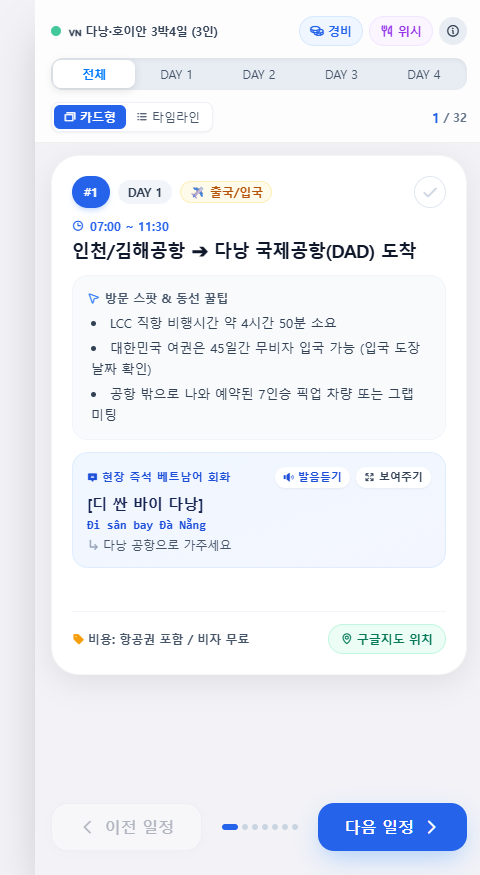

# 🧭 Global Trip Planner (글로벌 맞춤형 여행 플래너)

[](https://github.com/jaeminiz/awesome-agent-skills/releases/tag/v1.4.2)
[](https://www.skills.sh/jaeminiz/awesome-agent-skills/trip-planner)
[](../../LICENSE)

**[English](README.md)** | **한국어**

> **Antigravity AI 전문 여행 플래너 및 일정 아키텍트 스킬**  
> 전 세계 모든 국내외 여행지를 아우르며, 인터랙티브 문답을 통해 실시간 최저가·환율·트렌드를 반영한 정밀 마스터 일정표, **구글 내 지도(Google My Maps) 일자별 CSV 및 올인원 KML**, 그리고 **애플 아이폰(iOS) 스타일 카드뉴스 웹 애플리케이션**을 자동 생성합니다.

---

## 🌟 주요 특징 (Core Features)

1. **인터랙티브 맞춤형 플래닝 (Interactive Planning First)**
   - 일방적으로 일정을 임의 작성하지 않고, 여행 기간, 인원 구성, 이동 방식, 숙소 선호, 여행 테마를 문답을 통해 파악합니다.
2. **실시간 검색 기반 정밀 데이터 (Real-Time Search)**
   - 브라우저 검색을 통해 실시간 항공권/숙소 최저가를 직접 조사하고, 당일 실시간 환율(VND, JPY, USD, EUR 등)을 적용해 정밀 예산을 산출합니다.
3. **트렌드 미디어 심층 큐레이션 (Curated Gourmet & Spots)**
   - 여행 유튜버, 블로그, 인스타그램, 구글맵 최신 리뷰 등을 분석하여 검증된 맛집과 감성 카페를 동선별로 큐레이션합니다.
4. **일자별 상세 타임라인 종합 정리표 & 구글맵 연동**
   - 분 단위 동선, 쇼핑 후 짐 정리 타이밍, 현지 맞춤 실전 회화(한글 발음, 원문, 뜻), 구글맵 다중 경유지 원클릭 동선 링크를 축약 없이 완벽하게 제공합니다.
5. **구글 내 지도(Google My Maps) 완벽 연동 산출물 세트**
   - **Day별 표준 8컬럼 CSV (`day1_itinerary.csv`, `day2_itinerary.csv`...)**: `날짜,시간,여행지,위도,경도,구글지도,설명,이동/메모` 8개 컬럼으로 구성. 정밀 위도/경도 좌표를 포함하여 구글 내 지도에서 1초 만에 자동 인식되며, [숫자의 순서] 스타일 선택 시 `1, 2, 3...` 번호 뱃지 마커가 자동 부여됩니다.
   - **올인원 & Day별 KML 파일 (`[도시]_mymaps.kml`, `[도시]_DayN.kml`)**: 구글 내 지도 웹 파서에 100% 호환되도록 XML 엔티티 이스케이프(`&amp;`) 및 문법 검증이 적용된 KML 파일 세트로 파싱 에러 없이 번호 마커와 상세 일정 팝업이 자동 완성됩니다.
   - 🗺️ **사용자를 위한 구글 내 지도 등록 표준 매뉴얼**:
     * **[방법 A: CSV로 등록 - 권장]**: [구글 내 지도](https://www.google.com/maps/d/) 접속 ➔ [새 지도 만들기] ➔ [가져오기] 클릭 ➔ CSV 파일 업로드 ➔ 구글 지도가 `위도`와 `경도`를 1초 만에 자동 감지(확인 클릭) ➔ 마커 제목으로 **`여행지`** 선택(완료) ➔ [스타일 지정: 숫자의 순서] + [라벨: 여행지] 선택 시 일정 순서대로 `1, 2, 3...` 번호 뱃지 마커 자동 생성.
     * **[방법 B: KML로 등록 - 원클릭]**: [새 지도 만들기] ➔ [가져오기] ➔ `.kml` 파일 드래그앤드롭 ➔ `&amp;` 엔티티 정제 완료로 파싱 에러 없이 장소와 상세 설명 팝업 즉시 등록.
     * 💡 **가져오기 실패 팝업 발생 시**: 이전 세션 캐시 문제이므로 브라우저를 **F5(새로고침)**한 뒤 새 레이어에 업로드하면 100% 정상 작동합니다.
6. **모바일 최적화 애플 아이폰(iOS) 스타일 카드뉴스 웹앱 (`[도시]_trip_cards.html`)**
   - **⛔ 양식 및 레이아웃 절대 변경 금지**: [`resources/ios_card_app_template.html`](resources/ios_card_app_template.html)을 그대로 복제하여 HTML DOM ID, CSS 클래스, 4대 모달 구조, `const itineraryData = [{ id, day, time, title, category, description, phraseKo, phraseJa, phraseMeaning, cost, mapQuery }]` JS 엔진을 단 1%도 변경하지 않고 생성합니다.
   - **1장씩 넘겨보는 카드뉴스 UI**: 화이트 글래스모피즘, 터치 스와이프 제스처, 순번/카테고리 뱃지, 완료 체크 기능.
   - **현지어 발음듣기 (TTS) & 점원 보여주기 모달 (`#modalShowJapanese`)**: 기기 내장 Web Speech API로 원어민 발음 음성 즉시 재생 및 대형 텍스트 풀스크린 모달 지원.
   - **상단 3대 필수 모달 (고정 레이아웃)**:
     * **`#modalBudget` (경비)**: 블루-인디고 그라데이션 총경비 하이라이트 박스 + 3개 섹션(식비, 현지 교통비, 관광/투어비).
     * **`#modalShopping` (위시)**: 일차 뱃지(`D1`, `D2`, `D3`) + 스팟명(`#순번`) + 상세 위치/쇼핑 팁 카드 리스트.
     * **`#modalEmergency` (비상/호텔)**: 다크 슬레이트(`bg-slate-900`) 숙소 택시 기사님용 주소 카드 & 귀국 공항 택시 기사님용 카드(`copyToClipboard` 원클릭 복사 버튼) + 긴급 비상 연락망 박스.

---

## 📋 6단계 글로벌 플래닝 프로세스 (Global Workflow)

```
[Phase 1] 초기 인터뷰 & 필수 질문 (전 세계 맞춤)
       ↓
[Phase 2] 브라우저 실시간 항공·숙소 최저가 & 현지 당일 환율 리서치 보고 ➔ [사용자 선택]
       ↓
[Phase 3] 동선 최적화 맛집 & 카페 글로벌 큐레이션 리스트 보고 ➔ [사용자 선택]
       ↓
[Phase 4] ⭐ 필수 상세 출력 (축약/생략 금지):
          1. 일자별 상세 타임라인 종합 정리표 (테이블 5개 컬럼)
          2. 구글맵 다중 경유지 동선 링크
          3. 당일 환율 적용 최종 정밀 예산표
       ↓
[Phase 5] 최종 산출물 생성 확인 질문 ("구글 내 지도 Day별 CSV, 올인원 KML, iOS 카드뉴스 웹앱을 생성해드릴까요?") ➔ [사용자 승인]
       ↓
[Phase 6] Day별 CSV, [도시]_mymaps.kml 및 [도시]_trip_cards.html 최종 생성
```

---

## 📱 실제 생성 샘플 미리보기 (Live Sample Preview)

스킬을 통해 자동으로 생성되는 모바일 최적화 애플 아이폰(iOS) 스타일 카드뉴스 웹 애플리케이션의 실제 캡처 화면 및 샘플 파일입니다.

<p align="center">
  
</p>

* 🌐 **샘플 웹앱 파일**: [`examples/danang_trip_cards.html`](examples/danang_trip_cards.html)  
  *(다운로드 후 브라우저로 열면 오프라인에서 직접 카드 스와이프, TTS 발음듣기, 검색 타임라인을 체험할 수 있습니다.)*
* 🗺️ **구글 내 지도 올인원 KML**: [`examples/danang_mymaps.kml`](examples/danang_mymaps.kml)  
  *(구글 내 지도에서 [새 지도 만들기] -> [가져오기]에 드래그하면 1~4일차 번호핀 및 상세 일정 팝업이 1초 만에 자동 생성됩니다.)*
* 📊 **구글 내 지도 표준 8컬럼 통합 CSV**: [`examples/danang_itinerary.csv`](examples/danang_itinerary.csv)
* 📂 **구글 내 지도 Day별 분리 CSV**:
  * [`examples/day1_itinerary.csv`](examples/day1_itinerary.csv) (1일차)
  * [`examples/day2_itinerary.csv`](examples/day2_itinerary.csv) (2일차)
  * [`examples/day3_itinerary.csv`](examples/day3_itinerary.csv) (3일차)
  * [`examples/day4_itinerary.csv`](examples/day4_itinerary.csv) (4일차)

---

## 📂 파일 구조 (Structure)

```
trip-planner/
├── SKILL.md                              # 스킬 메인 명세 및 6대 절대 원칙 가이드라인 (영문)
├── SKILL.ko.md                           # 스킬 메인 명세 및 6대 절대 원칙 가이드라인 (국문)
├── README.md                             # 영문 스킬 소개 및 사용 가이드
├── README.ko.md                          # 국문 스킬 소개 및 사용 가이드
├── sample_preview.png                    # 모바일 카드뉴스 웹앱 실제 스크린샷
├── examples/                             # 🌟 실제 생성 샘플 산출물 (다낭 3박 4일 풀세트)
│   ├── danang_trip_cards.html            # 모바일 카드뉴스 웹앱 샘플 (표준 iOS 템플릿 양식)
│   ├── danang_mymaps.kml                 # 구글 내 지도 올인원 KML
│   ├── danang_itinerary.csv              # 구글 내 지도 표준 8컬럼 통합 CSV 샘플
│   ├── day1_itinerary.csv                # 1일차 구글 내 지도 CSV
│   ├── day2_itinerary.csv                # 2일차 구글 내 지도 CSV
│   ├── day3_itinerary.csv                # 3일차 구글 내 지도 CSV
│   └── day4_itinerary.csv                # 4일차 구글 내 지도 CSV
├── references/
│   └── trip_planning_playbook.md         # 권역별(일본/동남아/유럽/미주) 플래닝 플레이북
└── resources/
    ├── master_itinerary_template.md      # 마스터 일정표 표준 Markdown 템플릿
    ├── budget_template.md                # 다통화 환율 및 정밀 예산안 템플릿
    ├── itinerary_template.csv            # 구글 내 지도 표준 8컬럼 CSV 템플릿
    ├── mymaps_template.kml               # 구글 내 지도 올인원 KML 템플릿
    ├── generate_maps_data.py             # Day별 CSV 및 올인원 KML 자동 빌드 스크립트
    └── ios_card_app_template.html        # 양식·레이아웃·4대 모달·itineraryData 고정 표준 템플릿
```

---

## 🚀 설치 및 사용법 (Installation)

### 1. Antigravity 글로벌 스킬로 설치
본 저장소를 클론하여 사용자의 Antigravity 글로벌 스킬 디렉터리에 배치합니다:

```bash
# Windows (PowerShell)
git clone https://github.com/jaeminiz/awesome-agent-skills.git
Copy-Item -Path "awesome-agent-skills\skills\trip-planner" -Destination "$HOME\.gemini\config\skills\" -Recurse -Force

# macOS / Linux
git clone https://github.com/jaeminiz/awesome-agent-skills.git
cp -r awesome-agent-skills/skills/trip-planner ~/.gemini/config/skills/
```

### 2. 프로젝트 전용 스킬로 설치
특정 워크스페이스에서만 사용할 경우 프로젝트 루트의 `.agents/skills/`에 배치합니다:

```bash
# 워크스페이스 루트에서 실행
New-Item -ItemType Directory -Force -Path ".agents\skills"
Copy-Item -Path "awesome-agent-skills\skills\trip-planner" -Destination ".agents\skills\trip-planner" -Recurse -Force
```
